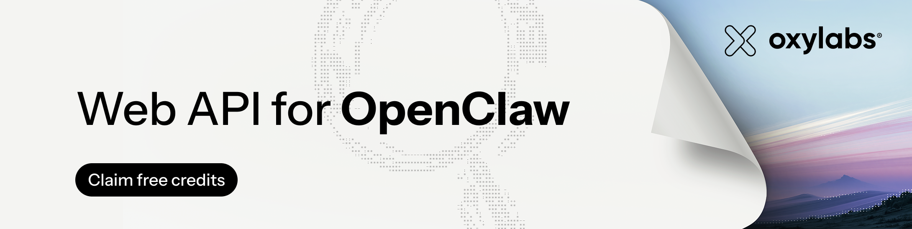

# Oxylabs Web API for OpenClaw

[](https://oxylabs.io/products/web-api?utm_source=github&utm_medium=referral&utm_content=openclaw-oxylabs-web-api&utm_campaign=banner&groupid=877)

<p align="left">
  <a href="https://dashboard.oxylabs.io"></a>
  <a href="https://developers.oxylabs.io/products/web-api?utm_source=github&utm_medium=referral&utm_content=openclaw-oxylabs-web-api&utm_campaign=banner&groupid=877"></a>
  <a href="https://dashboard.oxylabs.io"></a>
  <a href="https://discord.gg/Pds3gBmKMH"></a>
  <a href="https://www.youtube.com/@oxylabs"></a>
</p>

An [OpenClaw](https://openclaw.ai) plugin that adds the [Oxylabs Web API](https://oxylabs.io/products/web-api?utm_source=github&utm_medium=referral&utm_content=openclaw-oxylabs-web-api&groupid=877) as a provider for OpenClaw's built-in `web_search` and `web_fetch` tools.

- **web_search**: Google results with titles, URLs and a short outline of each page. Pass a country (`location: "DE"`) to see results as users in that country do.
- **web_fetch**: any page as Markdown or plain text, including JavaScript-heavy pages (turn on `renderJs`) and pages that block plain HTTP clients.

It plugs into the tools OpenClaw already has, so agents keep calling `web_search` and `web_fetch`; you choose Oxylabs with one setting.

## Requirements

- OpenClaw 2026.11.3 or later (Node 24.16+).
- An Oxylabs Web API key. Get one in the [Oxylabs dashboard](https://dashboard.oxylabs.io/).

## Install

```bash
openclaw plugins install npm:openclaw-oxylabs-web-api --force
```

OpenClaw asks for `--force` on any plugin installed straight from npm rather than from ClawHub, after warning that the source is outside ClawHub review. It also asks you to accept the plugin's capabilities (it makes network requests to `webapi.oxylabs.io`). In scripts, add `--accept-capabilities`.

## Configure

1. Give the plugin your key, either as an environment variable for the Gateway:

   ```bash
   export OXYLABS_WEB_API_KEY="your-web-api-key"
   ```

   or in OpenClaw's config (also available in the Control UI under Settings → Search):

   ```bash
   openclaw config set plugins.entries.oxylabs.config.webSearch.apiKey "your-web-api-key"
   ```

   The fetch provider uses the same key unless you set `webFetch.apiKey` separately.

2. Select Oxylabs for search, fetch, or both:

   ```bash
   openclaw config set tools.web.search.provider oxylabs
   openclaw config set tools.web.fetch.provider oxylabs
   ```

   `openclaw configure --section web` does the same interactively.

3. Check it:

   ```bash
   openclaw infer web providers --json
   openclaw infer web search --query "best espresso grinder" --json
   openclaw infer web fetch --url https://example.com --json
   ```

### Options

All under `plugins.entries.oxylabs.config`:

| Key | Default | What it does |
|---|---|---|
| `webSearch.apiKey` | `OXYLABS_WEB_API_KEY` | Web API key (string or SecretRef). |
| `webSearch.location` | none | Default two-letter country code for searches, e.g. `US`. A `location` given in the call wins. |
| `webFetch.apiKey` | `webSearch.apiKey`, then `OXYLABS_WEB_API_KEY` | Separate key for fetching. |
| `webFetch.renderJs` | `false` | Render pages in a browser before extracting them. Slower and uses more credits; turn it on if pages come back nearly empty. |
| `webFetch.timeoutSeconds` | `120` | How long a fetch may take. Slow pages are queued on the asynchronous API and polled within this time. |

The search result count follows `tools.web.search.maxResults` (1-20) unless the call gives `count`.

## Where your data goes

Search queries and the URLs you fetch are sent to the Oxylabs Web API (`https://webapi.oxylabs.io`), which runs the search or loads the page and returns the result. Requests are billed to your Oxylabs account. The plugin refuses to send private or internal addresses (localhost, private IP ranges), since Oxylabs cannot reach them. Requests carry an `x-oxylabs-sdk: oxylabs-web-api-openclaw/<version>` header so Oxylabs can count usage per integration; it contains no personal data.

Everything the tools return is marked as untrusted external content for the agent, like OpenClaw's other web providers do.

## Development

```bash
npm ci --ignore-scripts
npm run check      # type check
npm test           # unit tests
npm run build
OXYLABS_WEB_API_KEY=... npm run test:live   # calls the real API
```

To try a local build in OpenClaw:

```bash
npm pack --pack-destination /tmp
openclaw plugins install npm-pack:/tmp/openclaw-oxylabs-web-api-0.1.1.tgz --force --accept-capabilities
openclaw plugins inspect oxylabs --runtime --json
```

Releases: bump `version` in `package.json` and `src/constants.ts`, add a `CHANGELOG.md` entry, then push a `v<version>` tag. The `Publish` workflow publishes to npm with provenance.

## License

MIT
